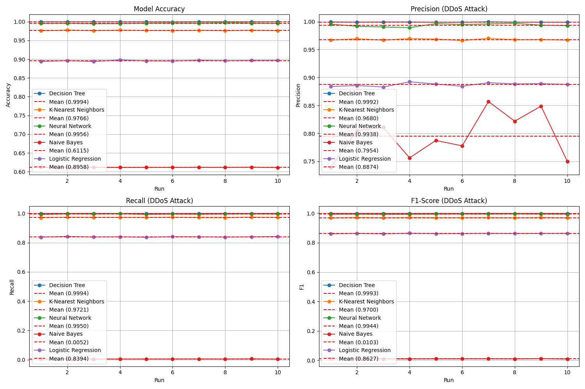

# ML-based DDoS Attack Detection in SDN

Benchmarking 5 ML classifiers for DDoS attack detection in Software-Defined Networking (SDN), evaluated with 95% confidence intervals.
Master's thesis, M.Sc. Artificial Intelligence and Computer Science, University of Birmingham (2025). Supervisor: Professor Ata Kaban.

## Overview

In an SDN, the controller centralises network control. That makes it a single point of failure and an attractive DDoS target, but it also gives a global view of traffic that machine learning can use to detect attacks.

This project compares five baseline classifiers under identical conditions on a public SDN DDoS dataset. Results from a single train/test split can be misleading, so each model is trained and tested over **10 independent stratified splits**. Every metric is reported as a **mean with a 95% confidence interval** (t-distribution).

**Main findings**

- **Decision Tree** performed best on every metric (F1 = 0.9993, 95% CI [0.9991, 0.9994]). Its confidence interval does not overlap with the next-best model's, so the lead is consistent across runs.
- The **Neural Network (MLP)** came second (F1 = 0.9944), followed by **K-Nearest Neighbors** (F1 = 0.9700).
- **Logistic Regression** was clearly weaker (F1 = 0.8627). This suggests the classes are not well separated by a linear boundary.
- **Gaussian Naive Bayes** reached 61% accuracy but detected only 0.5% of attacks (recall 0.0052). That accuracy is roughly what you get by predicting "normal" for every flow (61% of samples are normal). The case shows why accuracy alone is a poor metric for intrusion detection.

## Results

Mean over 10 runs, with the 95% confidence interval in brackets. Precision, recall and F1 treat **DDoS as the positive class**.

| Model | Accuracy | Precision | Recall | F1-score | Time / run* |
|---|---|---|---|---|---|
| Decision Tree | **0.9994** [0.9993, 0.9995] | **0.9992** [0.9990, 0.9994] | **0.9994** [0.9992, 0.9996] | **0.9993** [0.9991, 0.9994] | 0.8 s |
| Neural Network (MLP) | 0.9956 [0.9951, 0.9961] | 0.9938 [0.9919, 0.9957] | 0.9950 [0.9937, 0.9962] | 0.9944 [0.9937, 0.9951] | 14.8 s |
| K-Nearest Neighbors | 0.9766 [0.9760, 0.9771] | 0.9680 [0.9669, 0.9691] | 0.9721 [0.9711, 0.9730] | 0.9700 [0.9693, 0.9707] | 1.3 s |
| Logistic Regression | 0.8958 [0.8948, 0.8968] | 0.8874 [0.8852, 0.8896] | 0.8394 [0.8381, 0.8407] | 0.8627 [0.8615, 0.8640] | 1.0 s |
| Gaussian Naive Bayes | 0.6115 [0.6113, 0.6116] | 0.7954 [0.7664, 0.8245] | 0.0052 [0.0049, 0.0055] | 0.0103 [0.0097, 0.0110] | 0.03 s |

\*Average time per run for training plus prediction, measured on an Apple M1 Pro with 16 GB RAM. The full experiment (5 models × 10 runs) takes about 3 minutes.



*Accuracy, precision, recall and F1-score for each model across the 10 runs. Dashed lines show the means.*

## Dataset

- **Name:** DDoS SDN dataset (Kazin, 2021), available on [Kaggle](https://www.kaggle.com/datasets/aikenkazin/ddos-sdn-dataset)
- **Content:** Flow statistics collected from an SDN controller, labelled as normal traffic (0) or DDoS attack (1)
- **Size:** 104,345 rows × 23 columns. After 506 incomplete rows are removed, 103,839 rows remain (63,335 normal, 40,504 DDoS).
- The dataset is **not included** in this repository. Download it from Kaggle and save it as `dataset_sdn.csv` in the project folder.
- The original Kaggle column names (e.g. `src`, `pktcount`) are renamed automatically in the code.

## Methodology

### 1. Preprocessing
- Strip whitespace from column names, rename the original Kaggle columns to harmonised names, and check that all names are unique.
- Encode the target so that DDoS = 1. Text labels (`Normal` / `DDoS Attack`) are mapped automatically if present.
- Drop rows with missing values (506 rows).
- Integer-encode the categorical text columns (`src_ip`, `dst_ip`, `Protocol`).
- Clip impossible negative values in non-negative traffic features to 0, and add a binary `is_negative_*` flag column for each affected feature.

### 2. Feature engineering
The data is a sequential log from the SDN controller, so time-based features are derived from it:
- **Rolling statistics:** mean and standard deviation over a 5-sample window for packet count, byte count, packet rate, bytes per flow, and transmit, receive and total throughput.
- **Change features:** row-to-row change in packet rate and in bytes per flow.
- **Ratio features:** packet/byte ratio, flow density (flows per packet), throughput per packet, and an inter-arrival-time proxy (total duration per flow).
- Features with zero variance are removed, leaving **43 features**.

The code skips any feature that is not present in the loaded dataset, so the same pipeline runs on other SDN datasets with similar columns.

### 3. Models
All five are scikit-learn classifiers with default settings, apart from the changes below:

| Model | Settings |
|---|---|
| Decision Tree | fixed `random_state` |
| K-Nearest Neighbors | defaults (k = 5) |
| Neural Network (`MLPClassifier`) | `max_iter=500` so that training converges |
| Gaussian Naive Bayes | defaults |
| Logistic Regression | `solver='liblinear'`, `max_iter=500` |

### 4. Evaluation
- **10 runs.** Each run uses a different stratified 70/30 train/test split, with the run index as the random seed so results are reproducible.
- In each run, `StandardScaler` is fitted on the **training data only** and then applied to the test data. This prevents information from the test set leaking into training.
- **Metrics:** accuracy, precision, recall and F1-score.
- **95% confidence interval** for each metric: mean ± t₀.₉₇₅,₉ · s / √10, where s is the sample standard deviation across the 10 runs.

## Repository Structure

```
├── ml_ddos_detection_sdn.ipynb   # main notebook: full pipeline with outputs
├── ml_ddos_detection_sdn.py      # the same pipeline as a plain Python script
├── requirements.txt              # required Python packages
├── figures/
│   └── all_models_performance_plots.png
├── .gitignore
├── LICENSE
└── README.md
```

## Installation

Requires Python 3.10+. The project was developed with Python 3.13.5 and JupyterLab 4.4.3.

```bash
git clone https://github.com/fakhem-murshed/ml-ddos-detection-sdn.git
cd ml-ddos-detection-sdn

python3 -m venv venv
source venv/bin/activate        # Windows: venv\Scripts\activate
pip install -r requirements.txt
```

## Usage

1. Download the dataset from Kaggle (see [Dataset](#dataset)) and save it as `dataset_sdn.csv` in the project folder.
2. Run the experiment in one of two ways:

```bash
jupyter lab ml_ddos_detection_sdn.ipynb   # interactive, step by step
# or
python ml_ddos_detection_sdn.py           # run everything at once
```

Settings such as the number of runs, test split size, confidence level and random seed are collected in the `CONFIG` dictionary at the top of the code.

**Outputs:**
- A console summary with the mean, standard deviation, 95% CI and margin of error for each model and metric
- `all_models_performance_summary.csv` with the per-run scores for every model
- `all_models_performance_plots.png` with the per-run performance plots

## Limitations

- **One dataset.** All results come from a single public dataset. An earlier candidate dataset (SDN-DDoS Traffic Dataset, Hirsi et al., 2024) produced near-chance results with the same pipeline. The cause has not yet been identified.
- **Possibly optimistic scores.** The rolling-window features are computed on the full dataset before it is split, so neighbouring rows can share information across the training and test sets. Source and destination IPs are also used as features, which may let models memorise specific hosts. Both effects could make the scores higher than they would be on unseen networks.
- **No hyperparameter tuning.** The models use near-default settings, so the comparison is between baselines, not tuned models.
- **What the confidence intervals measure.** They capture variation across random splits of the same data. They do not measure performance on independent traffic.
- **Offline only.** The models are evaluated offline and are not integrated into a live SDN controller.

## Future Work

- Hyperparameter tuning with `GridSearchCV` and k-fold cross-validation
- Leakage-safe feature engineering, for example time-ordered splits and excluding IP addresses
- Evaluation on more SDN datasets, such as InSDN, to test generalisation
- Ensemble and deep learning models (Random Forest, XGBoost, CNN/LSTM)
- Plots with confidence intervals shown as error bars
- Real-time detection integrated with an SDN controller (e.g. Ryu, Mininet)

## Author

**Fakhem Murshed**
M.Sc. Artificial Intelligence and Computer Science, University of Birmingham
[fakhem.murshed@outlook.com](mailto:fakhem.murshed@outlook.com)

## Acknowledgements

- Dataset: A. Kazin (2021), *DDoS SDN dataset*, Kaggle
- Built with pandas, NumPy, scikit-learn, SciPy and Matplotlib

## License

The code is released under the MIT License. The dataset is subject to its original license on Kaggle.
